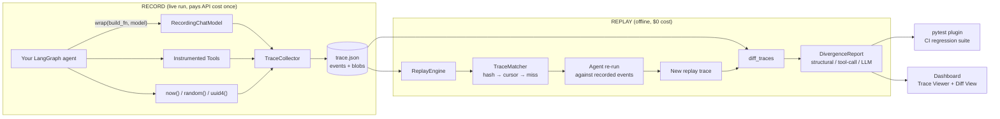

# AgentReplay

**Record an AI agent's run once. Replay it forever, offline, at $0. Catch regressions before they ship.**

[](https://github.com/hassanzafarr/AgentReplay/actions/workflows/regression.yml)


[](LICENSE)

AgentReplay is a deterministic record/replay and regression-testing harness for
[LangGraph](https://github.com/langchain-ai/langgraph) agents. It works like snapshot
testing or a flight recorder for LLM agents: it captures every non-deterministic input
during a real run, then plays that run back exactly. You can debug failures, test prompt
changes in CI, and compare model versions without paying for a single API call.

---

## TL;DR

| | |
|---|---|
| **Problem** | LLM agents give different results on every run. You can't reliably reproduce a bug, unit-test a prompt change, or compare two models, and re-running against the live API to "test" costs money every time. |
| **Solution** | Intercept the four sources of non-determinism (LLM responses, tool results, the clock, randomness), save them to a trace file, and feed them back on replay. The agent becomes a deterministic program. |
| **Result** | Any recorded run becomes a free, offline regression test. A one-word prompt edit is caught in CI with a readable diff showing exactly which call changed. |
| **Built with** | Python 3.11, LangGraph, LangChain Core, Pydantic v2, pytest plugin API, GitHub Actions, Next.js 16 + TypeScript + Tailwind |
| **Quality** | 100 unit/integration tests, golden-trace regression suite in CI, and a "tripwire" proof that replay makes zero live calls |

---

## See it work (60 seconds, no API key)

```bash
git clone https://github.com/hassanzafarr/AgentReplay.git
cd AgentReplay
pip install -e ".[dev]"
python -m examples.research_agent.demo
```

Real output, lightly trimmed:

```
================================================================
  1. RECORD a live run
================================================================
Recorded 2 events -> 88972ff4-....trace.json
  [0] llm_call  hash=d48492e0f6ba
  [1] llm_call  hash=acb72d0f1323

================================================================
  2. REPLAY offline against a tripwire model
================================================================
Tripwire fired: no  ->  0 live LLM calls, $0 spent
Matcher: 2 hash hits, 0 misses
Final state identical to recording: True
✅ Traces are IDENTICAL. No divergences found.

================================================================
  3. CATCH a regression: one word changed in a prompt
================================================================
Replay stopped at the changed call:
  REPLAY MISS: no recorded LLM response for hash 558a5b044488… — divergence from recorded trace.

❌ 2 divergence(s) found.
── LLM Outputs (2) ──────────────────────────
  [seq 0→0] prompt changed, output changed
      -[Recorded response for: Research this topic thoroughly: carbon capture and storage]
      +[Recorded response for: Research this topic briefly: carbon capture and storage]
  [seq 1→1] prompt changed
```

During replay the agent is given a **`TripwireModel`, a model that raises an exception
if it is ever called**. It never fires, which proves replay is fully offline. That is a
stronger guarantee than "we used a test key and the bill looked small."

---

## Why this is hard (and why `temperature=0` doesn't solve it)

An agent run depends on four impure inputs:

| Source | Example | Fixed by `temperature=0`? |
|---|---|---|
| **LLM responses** | Same prompt, different completion | Partly. Providers still don't guarantee identical output. |
| **Tool / API results** | A search API returns different data next week | No |
| **The clock** | `datetime.now()` changes every call | No |
| **Randomness** | `random()`, `uuid4()` | No |

AgentReplay controls all four.

---

## Features

### 1. Record: one line to instrument an agent
```python
import agentreplay
from langchain_anthropic import ChatAnthropic

wrapped = agentreplay.wrap(build_fn=build_my_agent, model=ChatAnthropic(model="claude-sonnet-5-5"))
result = wrapped.invoke({"topic": "quantum computing"})
# -> ./traces/<run_id>.trace.json
```
Every LLM call, tool call, `agentreplay.now()`, and `agentreplay.random()` / `uuid4()`
is stored as a typed, ordered event. Large payloads are content-addressed into a `blobs`
map so traces stay small.

### 2. Replay at $0
```python
from agentreplay import ReplayEngine, TraceWriter

trace = TraceWriter.read("traces/<run_id>.trace.json")
# TripwireModel: any BaseChatModel that raises if called (see examples/research_agent/demo.py)
result = ReplayEngine(recorded_trace=trace, build_fn=build_my_agent, model=TripwireModel()).run(
    {"topic": "quantum computing"}
)
print(result.divergence_report.format_report())
```

### 3. Divergence detection: three tiers, all free
1. **Structural**: did the agent take the same path through the graph?
2. **Tool calls**: same tool, same arguments, same output?
3. **LLM calls**: same prompt, same response? Shown as a unified diff.

### 4. Traces become pytest tests in CI
```toml
# pyproject.toml
[tool.pytest.ini_options]
agentreplay_traces = "traces/"
agentreplay_agent  = "myagent:build_agent"
```
```
$ pytest
traces/6eb6f580.trace.json::6eb6f580 PASSED
traces/9cc11011.trace.json::9cc11011 FAILED
  ❌ 1 divergence: prompt changed at seq 0
```
This repo runs that suite on every push and PR ([regression.yml](.github/workflows/regression.yml)).
No API key is needed in CI.

### 5. Visual dashboard
A client-side Next.js app. Traces are parsed and diffed in the browser, and nothing is
uploaded.
- **Trace Viewer**: colour-coded event timeline with a click-to-inspect panel (full prompts, responses, tool args)
- **Diff View**: load a baseline and a candidate, and see structural, tool, and LLM divergences side by side
- Bundled sample traces, so you can try it without uploading anything

```bash
agentreplay serve          # http://localhost:3000
```

### 6. CLI
```bash
agentreplay show traces/run.trace.json            # pretty-print a trace
agentreplay diff traces/old.trace.json traces/new.trace.json
agentreplay serve [--port N]                      # launch the dashboard
```

---

## Architecture



```
agentreplay/
├── schema/trace.py            # Pydantic v2 models: the record/replay contract
├── recorder/
│   ├── interceptor.py         # RecordingChatModel: BaseChatModel wrapper, no monkeypatching
│   ├── tool_wrapper.py        # Captures tool inputs/outputs
│   ├── clock.py, rng.py       # Scoped virtual clock + RNG
│   ├── collector.py           # Thread-safe event log with atomic sequence counter
│   └── trace_writer.py        # JSON persistence with schema validation
├── replayer/
│   ├── replay_engine.py       # Re-runs the agent against a recorded trace
│   ├── matcher.py             # Hybrid hash + cursor matching
│   └── divergence.py          # 3-tier diff + human-readable report
├── integrations/
│   ├── langgraph.py           # wrap(): public record API
│   └── pytest_plugin.py       # Turns *.trace.json files into test items
└── cli.py                     # show / diff / serve
dashboard/                     # Next.js + TypeScript trace inspector (diff logic ported to TS)
examples/research_agent/       # Demo agent, golden traces, end-to-end demo script
```

---

## Engineering highlights

Each decision below includes the alternative I rejected and why.

| Problem | Decision | Rejected alternative |
|---|---|---|
| **How to intercept LLM calls** | Wrap LangChain's `BaseChatModel`. It is a stable extension point that works with any provider, and every call in the graph flows through it. | Monkeypatching provider SDKs: fragile, per-provider, and blind to LangChain's message normalisation. |
| **Matching a call to its recording** | **Hybrid: content hash first, ordered cursor second, miss = reported divergence.** The hash survives reordered code paths, and the cursor disambiguates identical repeated prompts (retry loops). | Pure ordering breaks on parallel nodes. Pure hashing can't tell two identical retries apart. |
| **What happens when replay doesn't match** | A miss is a **reported feature, not a crash**. It becomes the test-failure message. | Throwing a generic error, which tells the developer nothing. |
| **Trace format** | One JSON file per run, a Pydantic v2 discriminated union of 4 event types, a global `seq` for async ordering, content-addressed blobs, and `schema_version` frozen at 1. | Ad-hoc dicts, which give no validation and silently corrupt old traces. |
| **Clock & randomness** | Virtualised inside a context manager that is scoped to the run. | Global patching at import time, which pollutes the host process and other tests. |
| **Proving zero cost** | A tripwire model that raises if called. | Checking the API bill: indirect, slow, and not provable in CI. |

### How it was built
The project was built in gated phases, and each phase had to pass its tests before the
next started:

| Phase | Deliverable | Gate |
|---|---|---|
| 0. Spike | Prove interception + byte-identical replay | 4/4 gate tests, tripwire never fires |
| 1. Recorder | Schema, interceptors, virtual clock/RNG, `wrap()` | 50 tests |
| 2. Replayer | Replay engine, hybrid matcher, 3-tier diff, CLI | 92 tests |
| 3. CI | pytest plugin, GitHub Actions regression suite | 100 tests |
| 4. Dashboard | Next.js trace viewer + diff view | Production build + type-check |

---

## Testing

```bash
pytest tests/ -q                     # 100 unit + integration tests, ~2s
pytest examples/research_agent/ \
  --agentreplay-traces=examples/research_agent/traces \
  --agentreplay-agent=examples.research_agent.agent:build_agent   # golden-trace regression suite
```
Each test's docstring states what it proves *and* what it deliberately does not cover.

---

## Limitations (v1)

I chose these limits on purpose to keep v1 focused:
- **LangGraph only.** CrewAI and raw OpenAI loops are not supported yet, although the interception design carries over.
- **Read-mostly tools.** Write side effects are not sandboxed during replay.
- **Final message only.** Replay restores the final message, not the token stream.
- **Node-name-based structural diff.** Renaming a node shows up as noise in the diff.
- **SDK calls that bypass `BaseChatModel`** are not intercepted. They surface as missing events instead of failing silently.

## Roadmap
- Opt-in semantic diff using an LLM judge ("did the meaning change?")
- CrewAI and raw OpenAI SDK adapters
- Sandboxed replay for write-side-effect tools
- PyPI release

---

## License

[MIT](LICENSE) © Hassan Zafar
